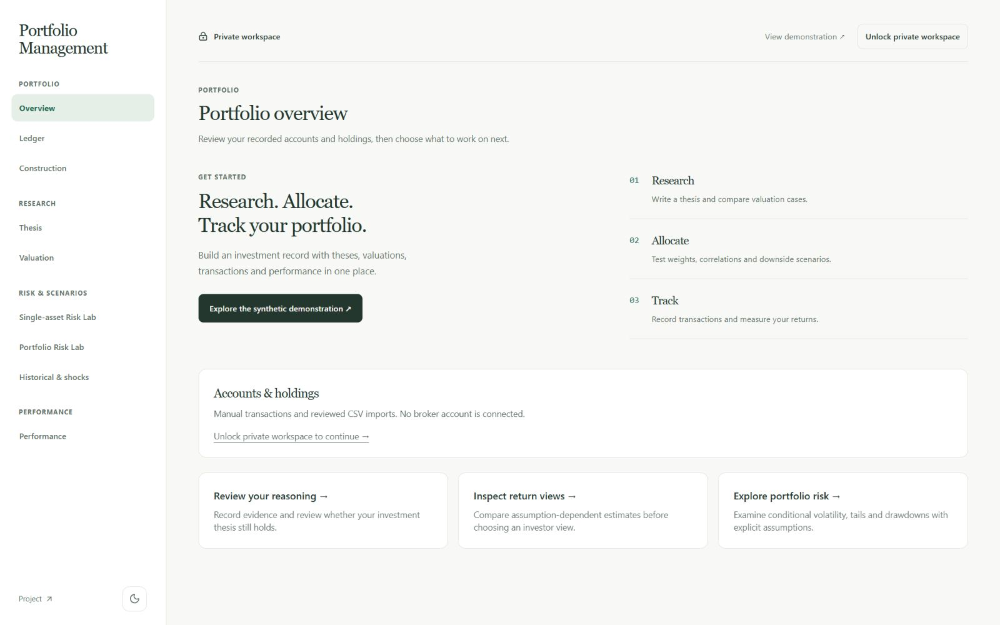

# Portfolio Management

**Research investments, build allocations, record transactions and understand portfolio performance in one place.**

Portfolio Management connects the work that usually lives across spreadsheets, broker exports and scattered research notes. Record why you own an investment, examine its valuation, test how an allocation behaves, and measure what happened after transactions and cash flows.

[Open the platform](https://stochastic-market-simulator.fly.dev/) · [Explore the public demonstration](https://stochastic-market-simulator.fly.dev/demo) · [Methodology](docs/METHODOLOGY.md)



The public demonstration uses **fictional securities, synthetic transactions and synthetic prices. No real money is invested.** It illustrates the workflow; it is not a verified personal track record. The Single-asset and Portfolio Risk Labs work without a key. Saved portfolios and research belong to the site operator and require an owner key. There is no public account registration or connected brokerage account.

## What it helps you do

- **Keep a research record.** Capture a company's investment thesis, supporting observations, valuation cases, risks and the conditions that would change your mind.
- **Compare allocations.** Examine position weights, diversification, constraints and each holding's contribution to volatility.
- **Explore downside.** Run single-asset and portfolio scenarios, inspect loss probabilities and drawdowns, and apply historical or explicit shocks.
- **Maintain a portfolio ledger.** Record trades, funding, dividends, fees, FX and corrections; derive positions and cash from the transaction history.
- **Measure returns.** Separate investment performance from the timing of your deposits and withdrawals, then inspect calendar returns and position contributions.
- **Share a controlled demonstration.** Publish selected synthetic research and portfolio snapshots without exposing private drafts or raw account records.

## Explore without a key

Open the [public demonstration](https://stochastic-market-simulator.fly.dev/demo). It is read-only and includes:

- portfolio growth and drawdown charts;
- time-weighted returns and a clearly labelled synthetic comparison;
- monthly and annual returns, with partial periods identified;
- dated holdings, cash and the complete closed-position history, including losses;
- fictional investment theses, revisions and example reviews;
- a decision and correction journal;
- methodology, publication history and a downloadable synthetic snapshot.

The demonstration has a deliberately short sample period. Missing measurements stay unavailable; they are not replaced by invented results. New publications receive their own version, and corrections remain visible.

## Workspace guide

The platform has nine workspaces. Both Risk Labs are public and require no key. Unlock once to use saved accounts and research; that private connection is shared across the other tabs.

| Workspace | What you can do | Start with |
| --- | --- | --- |
| **Overview** | See your recorded accounts, holdings and cash balances by currency. Move directly into research, valuation or risk analysis. | Select an existing portfolio, or create one in Ledger. |
| **Ledger** | Create separate portfolio records; enter transactions; review holdings and trade-date cash; import reviewed canonical CSV; record reversals and replacement corrections. Value the account using dated prices and FX supplied by you. | An account name, base currency and reviewed transaction details. |
| **Construction** | Compare a hypothetical allocation with equal weight, minimum variance, maximum Sharpe and equal risk contribution. Inspect constraints, volatility contributions and explicit return-view assumptions. | Registered equities, aligned total-return history, currency/calendar context and position bounds. |
| **Thesis** | Register equities, save research observations, write bear/base/bull narratives and invalidation conditions, preserve revisions, and record reviews such as hold, reduce or exit. | A security identity and your investment reasoning. |
| **Valuation** | Evaluate user-specified returns, scenario sets, fundamental assumptions, reverse valuation, CAPM and historical diagnostics. Save estimates and deliberately adopt a return view. | A security, valuation date, horizon, return conventions and model assumptions. |
| **Single-asset Risk Lab** | Generate conditional paths for one ticker using Gaussian, Gaussian mixture or EWMA volatility models. Inspect return percentiles, loss probability, volatility, drawdown, VaR and Expected Shortfall. | A ticker, historical window, horizon and initial value. |
| **Portfolio Risk Lab** | Model assets jointly using Gaussian or joint Gaussian mixture distributions. Compare correlations, signed volatility contributions, tail outcomes and buy-and-hold versus daily rebalancing. | At least two tickers and weights totalling 100%. |
| **Historical & shocks** | Replay supplied historical observations, resample joint returns using a block bootstrap, or apply explicitly specified asset shocks. | A named scenario, aligned history or shocks, and portfolio weights. |
| **Performance** | Calculate time-weighted and money-weighted returns, daily unit values, drawdowns, calendar returns and reconciled position contributions. Compare against reviewed benchmarks and inspect supported historical factor analysis. | A ledger, a measurement period and complete dated price/FX evidence. |

Research, allocation and performance tools use the records and inputs you supply. They do not silently fetch fundamentals, choose investment views or infer missing FX rates. The Risk Labs are the separate workflow that downloads historical adjusted-close prices for entered tickers.

## A typical workflow

### 1. Research an investment

In **Thesis**, register the equity with its exchange and currency. Describe the business, the opportunity, the main risks and what would invalidate your reasoning. Save a revision before recording a later review, so the original view remains available.

Use **Valuation** to explore the assumptions behind the opportunity. A bear/base/bull scenario set can show how outcomes depend on your inputs. A model estimate becomes an investor return view only when you explicitly choose it; it is not adopted automatically.

### 2. Test an allocation

In **Construction**, supply aligned return observations and position bounds. Compare candidate weights and inspect risk contributions. Return-dependent strategies require explicit suitable return views; historical averages are not silently treated as forecasts.

For a ticker-based scenario, open **Portfolio Risk Lab**:

1. Enter at least two tickers, for example `NVDA`, `AAPL` and `MSFT`.
2. Enter weights such as `40`, `40` and `20`. **Normalize** rescales entered weights to 100%.
3. Choose the historical estimation window, modeled horizon and initial value.
4. Choose **Multivariate Gaussian** for a single fitted distribution, or **Joint GMM** for a mixture with different covariance structures.
5. Open **Advanced settings** to change path count, seed, confidence, risk-free rate, covariance estimator or rebalancing.
6. Run the scenarios. Review the distribution, tail losses and drawdowns alongside the assumptions and data dates.

The result report groups the main risk measures above supporting ratios. In the path chart, choose a **Focus trace** for its tooltip value, drag the range handles to zoom, or use their arrow-key controls. **Show full sample** expands the visible traces. These display controls do not recalculate statistics. The distribution chart shows full-population counts, with restrained loss/gain colours and exact bin ranges in tooltips. The percentile table highlights the median; portfolio results also include signed volatility contributions and a correlation heatmap. Chart transitions respect reduced-motion preferences.

Prices are cached in the running service for one hour. A repeated run can reuse downloaded history. The public Risk Labs share a limit of 12 requests per minute and one active simulation to fit the small deployment; a busy response asks you to retry. Large requests are rejected before allocating simulation tensors. Market-data availability and host wake-up time can affect the first run.

**These are conditional scenarios, not price targets or forecasts.** The default uses zero mean log return, which does not imply zero expected simple return. The valuation currency labels outputs; it does not perform FX conversion. Changing a saved valuation view does not automatically change simulation drift.

### 3. Record what happened

Create a portfolio in **Ledger**, then record funding and transactions. Review quantities and cash balances before supplying dated valuation inputs. Correct mistakes through reversals and replacement entries rather than rewriting history.

Manual entry and the project's reviewed canonical CSV format are supported. An arbitrary broker CSV is not automatically compatible. There is no live broker synchronization, order execution or automatic reconciliation.

### 4. Review performance and decisions

In **Performance**, select the account and period, then supply the required price and FX coverage. Time-weighted return measures the investment experience independently of external cash-flow timing. Money-weighted return reflects the timing of invested capital; it can be unavailable when no unique meaningful solution exists.

Inspect drawdowns, calendar periods and contributions before returning to **Thesis** to record a review. Benchmarks require an explicit identity and compatible supplied history. Importing a factor dataset does not automatically establish that its dates, currency or return conventions match the portfolio.

## Private workspace access

The Risk Labs do not require sign-in or a key. Saved accounts, research and publication controls are for the operator, not a public multi-user service. Click **Unlock private workspace**, paste the owner key and choose **Unlock workspace**. It is not a broker password or a market-data API key.

The key remains in the current tab's memory. Locking or refreshing clears the connection and unsaved private work; saved server records remain. A key is never embedded in the public frontend or demonstration download.

For the existing operator's Windows checkout, recover the locally protected deployment key with:

```powershell
.\scripts\owner-access.ps1
```

This creates `.verification/owner-access.txt`, ignored by Git and restricted to the current Windows user. Open that file locally and copy the key into the application. Do not upload or share it. Recovery requires the original protected file and Windows account; a new installation must configure its own server-side `RESEARCH_API_KEY`.

## What the numbers mean

- **Assumptions remain visible.** Model, horizon, currency, sample dates, rebalancing, risk-free rate and data limitations accompany results.
- **Historical risk and expected return are separate.** Observed returns can inform risk estimates; a forward return view requires a declared modelling choice.
- **Charts illustrate; full populations determine statistics.** Scenario percentiles and risk metrics use all simulated paths, not the small chart sample.
- **Volatility contribution and performance contribution differ.** One describes portfolio risk under its inputs; the other explains measured returns.
- **Incomplete inputs stay incomplete.** Missing coverage or undefined metrics are reported explicitly.
- **Demo, paper and real histories remain distinct.** A synthetic example cannot become a verified funded-account record by changing a label. Prospective paper operation and real-account integration are not part of the current public release.

This is a personal research platform, not investment advice, a recommendation service or an execution venue. Historical performance and synthetic scenarios do not establish future returns.

## Run your own workspace

The application uses a React frontend, a Python/FastAPI calculation service and PostgreSQL for private records. A local installation requires Python 3.12, Node.js 22 and a separate PostgreSQL database.

1. Run `scripts/bootstrap.ps1` to create the backend environment and install frontend dependencies.
2. Configure `DATABASE_URL` using the `postgresql+psycopg://` driver and your own `RESEARCH_API_KEY` of at least 32 characters. Keep credentials outside Git.
3. From `backend`, apply `python -m alembic upgrade head` and run `python -m uvicorn main:app --reload` using the project environment.
4. From `frontend`, run `npm run dev`. Local development defaults to the API at `http://localhost:8000`.
5. Unlock with the key you configured, then register securities and create your own portfolio. Synthetic setup is a deliberate separate workflow, described in [Demonstration](docs/DEMONSTRATION.md).

Production builds use same-origin `/api` requests. Fly serves both frontend and API; the Vercel configuration proxies API requests to the same Fly service. There are no frontend secrets. Deployment, backup and access procedures are in [Operations](docs/RELEASE_OPERATIONS.md).

## Further reading

[Calculation methodology](docs/METHODOLOGY.md) · [Accounting conventions](docs/ACCOUNTING.md) · [Performance measurement](docs/PERFORMANCE.md) · [Valuation models](docs/METHODOLOGY.md#fundamental-terminal-wealth-valuation) · [Portfolio construction](docs/METHODOLOGY.md#allocation-alternatives-and-numerical-limits) · [Public demonstration](docs/PUBLIC_DEMONSTRATION.md)

Development plans and historical verification records remain in `PLAN.md` and `docs/`; they are separate from this user guide.
